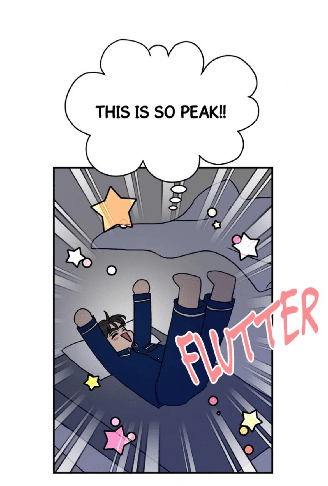
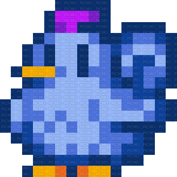

# Reykjavik Salvador 

*computer science and engineering @ uc merced*

 

### About Me 

Heyy! I'm Reykjavik, and I'm a 4th year CSE student at UC Merced graduating in December 2026. In terms of my favorite topics in computer science, I love networks and IoT!! But, I'm also big on environmental health and air quality.

 

### Social

 

### Tech Stack

- **IoT, Embedded & Networking:** TinyOS, OMNeT++, Veins, INET, SUMO, Raspberry Pi, Wireless & Multi-Hop Routing Protocols, Signal Processing
- **Interests:** Embedded sensor networks, Ad-hoc networks, Edge AI, connected-device software, environmental health monitoring

 

### Current Projects

| Project | Focus | Stack |
| :--- | :--- | :--- |
| **EmbedQB** | Wearable motion sensor system that tracks and evaluates football throwing form in real time | `C++` `XIAO MG24 Sense` `Python` |
| **Matter over Thread Node** | Low-power smart device prototype built to communicate over a wireless mesh network | `C++` `XIAO MG24` `Python` |
| **Pi Air Quality Monitor** | Indoor particulate/gas telemetry streaming with real-time trend visualization | `Python` `Flask` `SQLite` `Raspberry Pi` |

 

